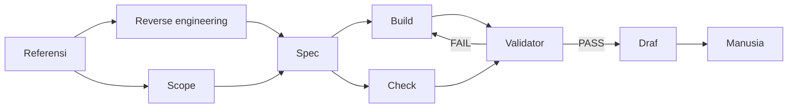

# Template: workflow file dari method-guide article

Copy file ini untuk artikel bertipe **method guide / essay** yang di-quote dari
X. Jangan dipakai untuk writeup finding nyata (itu masuk checklist Web/API
atau workflow audit stack). Isi bagian kurung dengan data asli mesin dan
operator. Tulis dalam register operator, tanpa em-dash.

---

# Workflow tim AI untuk [domain kerja]

Adaptasi dari *[judul artikel]* oleh [author]. Artikel aslinya method guide
generik, bukan bukti atau writeup finding. Kerangkanya dipakai di sini, detailnya
disesuaikan dengan stack dan aturan kerja sendiri.

Dibuat [tanggal]. File ini satu-satunya workflow [jenis artifact] yang dipakai.
Checklist [nama checklist lain] tetap di [path].

## 0. Aturan main

- [Gate yang berlaku tiap kali, misalnya: hanya impact yang dibayar yang dikejar]
- [Syarat bukti, misalnya: PoC satu perintah + verifikasi identitas]
- [Pembagian kerja agen vs manusia: agen menyiapkan artifact, manusia yang
  melakukan aksi pada akun / submit publik]
- [Satu hipotesis impact diproses sampai selesai sebelum buka hipotesis lain]
- [Setiap handoff membawa file, requirement tertulis, dan check yang harus
  dilalui; tidak ada handoff lewat ingatan chat]

## 1. Peran dengan batas jelas

Tabel wajib. Kolom: peran, tugas, alat di mesin ini, output wajib. Nyalakan
nama alat dan path aslinya (bukan nama generik), supaya sesi berikutnya tidak
nebak. Nyatakan bahwa alokasi itu usulan, bukan ranking.

| Peran | Tugas | Alat di mesin ini | Output wajib |
|---|---|---|---|
| [Scope] | [Cek batas dan prior art] | [alat nyata] | [file] |
| [Reverse engineer] | [Ubah target jadi requirement teruji] | [alat nyata] | [file] |
| [Builder] | [Buat bukti / implementasi] | [path penuh binary] | [file] |
| [Checker] | [Jalankan gate dan kontrol negatif] | [skill / script] | [file] |
| [Coordinator] | [Atur graph, artifact, retry, eskalasi] | [agen] | [file] |

Tambahkan catatan alat: model yang cuma bisa menyarankan kode belum tentu bisa
menjalankannya; model tanpa akses web tidak bisa verifikasi sumber. Jangan beri
peran riset ke agen tanpa search. Kalau job berat, sebutkan alternatif offload
yang tersedia dan minta rekomendasi dulu sebelum jalan di lokal.

## 2. Graph dependensi

Sertakan diagram Mermaid dan daftar eksplisit "yang lewat di tiap sambungan".
Sambungan gagal biasanya karena isi handoff tidak didefinisikan, bukan karena
teknologinya.

Cek resource bersama: dua task bisa konflik kalau menulis file yang sama.

## 3. Langkah asli artikel, versi konkret

Buat satu sub-bab per langkah dari artikel sumber. Untuk tiap langkah:

- prompt atau perintah yang bisa disalin
- contoh output yang bisa diuji, bukan kalimat umum
- keputusan yang menghentikan langkah itu

Contoh pola yang hampir selalu relevan:

- Tulis kontrak "selesai" SEBELUM implementasi, pakai assert pada nilai nyata.
- Loop: Produce, Check, Correct, Check lagi. Laporan gagal harus berisi unit,
  perintah repro, hasil aktual, hasil diharapkan, dan scope yang boleh diubah.
- Hindari "bikin lebih bagus". Itu bukan laporan kegagalan.
- Kirim balik unit yang gagal saja, jangan regenerate seluruh pekerjaan.
- Batas retry 3 kali sebagai titik awal, lalu simpan percobaan dan eskalasi.
- Simpan pelajaran yang sudah dikonfirmasi dengan scope, bukti, dan status
  bisa direvisi. Riwayat chat penuh berisi asumsi yang dibuang.

## 4. Layout artifact per target

Tunjukkan pohon direktori nyata. Satu folder per target, satu subfolder per
temuan. File minimal: scope, known issues, requirements, spec, checks, poc,
evidence, check results, draf, lessons, trace. Simpan path dengan gaya
`C:/...` kalau dibaca program native.

## 5. Ringkasan kontrak

Checklist pendek berisi syarat minimum sebelum artifact dianggap selesai.
Sertakan gate validasi yang sudah ada di skill-stack operator, jangan
ulang-ulang isinya.

Kalau semua kandidat gugur di gate saat workflow dipakai pada target nyata,
tetap tulis seluruh artifact dan draf yang diberi label TIDAK DIKIRIM dengan
alasan per kandidat. Jangan berhenti di jawaban chat "tidak ada temuan" dan
jangan mengangkat hipotesis yang sudah digugurkan jadi finding.

## 6. Urutan kerja singkat

6 sampai 8 langkah bernomor, urutan eksekusi.

## 7. Baseline dan evaluasi

Jalankan satu workflow utuh lebih dulu, bandingkan dengan percobaan model
tunggal. Catat waktu, biaya, defect tersisa, dan frekuensi intervensi manusia.
Kalau koordinasi lebih banyak kerja daripada yang dihilangkan, sederhanakan
graph.

## Catatan provensi

Cantumkan status id artikel dan post promosi, cara konten diambil (fxtwitter
inline quote, Jina, atau live render), dan pisahkan klaim promosi poster dari
isi artikel. Nyatakan bila tidak ada repo, kode, atau hasil uji yang disertakan
sumber.
